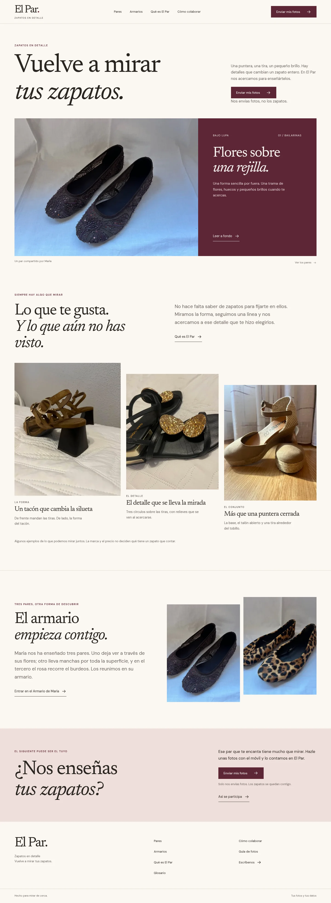
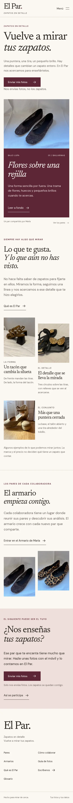
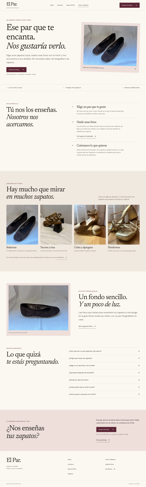
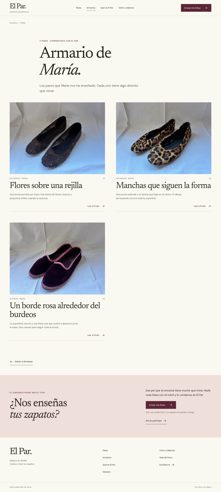
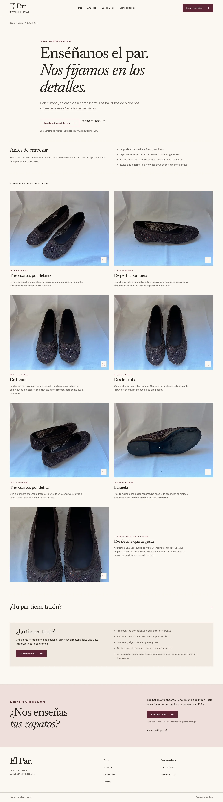
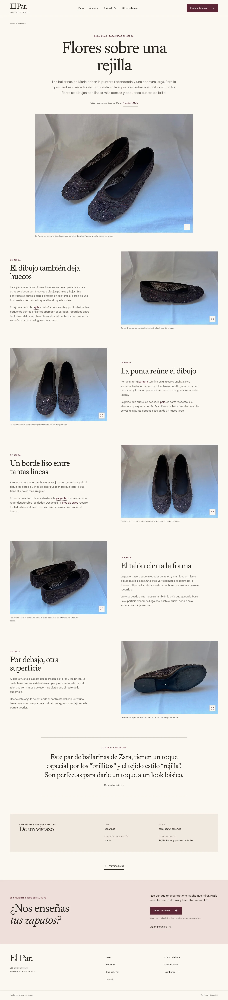

# Revisión de la web

Reconstrucción desde `par-astro`, comprobada el 6 de octubre de 2026. Las capturas y el resumen son de esa fecha, con los tres pares de María, sin dominio ni indexación activada; la web ha cambiado después (ver [Diseño](DISENO.md)). Las verificaciones de abajo sí describen las comprobaciones vigentes.

## Resultado

El camino hasta mandar un par es portada o cualquier página → Cómo colaborar → guía de fotos → Tally. El final de la guía abre el formulario. Quien ya tiene las fotos encuentra arriba, en Cómo colaborar y en la guía, un acceso directo discreto: «¿Ya tienes las fotos? Envíalas directamente». Hay un catálogo de pares, tres análisis, índice de armarios y Armario de María, presentación de El Par, glosario y condiciones de colaboración. Las definiciones también aparecen dentro del análisis y las fotografías pueden ampliarse con teclado.

Se usa la presentación aprobada de Drive, las fotografías autorizadas y citas de las colaboraciones. Los análisis son borradores nuevos basados en las fotos; no se presentan como textos previamente aprobados. El formulario de Tally permanece intacto.

## Inicio en escritorio

## Inicio en móvil

## Cómo colaborar

## Armario de María

## Guía de fotos

## Análisis con bloques MDX

## Verificaciones

Lo que se comprueba hoy en cada cambio, desde `sitio/` (ver README):

- `npm run verify` y `npm run verify:review`: tipos y compilación de Astro sin errores, advertencias ni sugerencias, y `scripts/verify-build.mjs` sobre cada documento HTML: enlaces locales, anclas, identificadores únicos, un solo título principal, descripción, imágenes con texto alternativo y medidas, anchos reales de cada srcset, nada en línea ni imágenes `data:` (CSP), ninguna expresión descartada (también la raya larga), ningún correo distinto de elparzapatos@proton.me y ningún «análisis» en el texto legible. También revisa las [convenciones del código](CONVENCIONES.md).
- `npm run test:content`: prueba de crecimiento en una copia temporal con 60 pares más (detalle en [Contenido](CONTENIDO.md#qué-enseña-la-portada)).
- `npm run test:e2e`: 43 pruebas de navegador en Chromium sobre la vista de revisión: todas las rutas en siete anchos de 320 a 1440 px, recorrido hasta Tally y acceso directo, portada, visor (se abre pulsando la foto y acerca con clic, rueda, botón o dedos), compartir con «Copiar enlace», Cómo colaborar, menú por teclado, definiciones (teclado, ratón y toque), guía (impresión, tres vistas por fila en escritorio y foto antes del texto en el móvil), glosario, armarios y su abanico, «Más retratos», página no encontrada, lectura sin JavaScript, transiciones, marcas sobre la foto, «Medir puntos», «reducir movimiento», axe con reglas WCAG 2 A/AA y 2.1 AA, y ninguna violación de la CSP ni error o aviso de Chrome. Superar la auditoría automática no certifica accesibilidad completa.
- `npm run format:check`: formato de Prettier.

El flujo de GitHub Actions (`.github/workflows/verifica-web.yml`) repite formato, compilación, verificación y pruebas y conserva el resultado como artefacto, sin desplegarlo; hoy solo se lanza a mano, porque sus disparadores siguen apuntando a las ramas antiguas `par-astro` y `reconstruccion/el-par-desde-par-astro`.

Comprobado a mano el 6 de octubre, sin repetirse desde entonces: dependencias de producción sin vulnerabilidades en la auditoría de npm; servidor de desarrollo en una copia temporal (al guardar cambios de título y posición de la cita en MDX, la entrada local se actualiza sin editar una plantilla); variables de lanzamiento con un dominio de prueba (canónicas, sitemap, robots e Instagram).

La reorganización del CSS se comparó en 33 vistas (11 rutas a 390, 768 y 1440 px): mismas dimensiones y estilos calculados antes y después. Las reglas responsive están junto a su familia y la entrada de estilos documenta su orden.

## Antes de hacerla pública

Revisar los tres borradores con María; cerrar el alojamiento y formato definitivo de las imágenes; completar los datos legales y elegir dominio/cuenta de despliegue. [Lanzamiento](LANZAMIENTO.md) contiene los pasos y [decisiones de imágenes](IMAGENES-PENDIENTES.md) compara las opciones. Cloudflare Pages sigue siendo adecuado para esta web estática.
